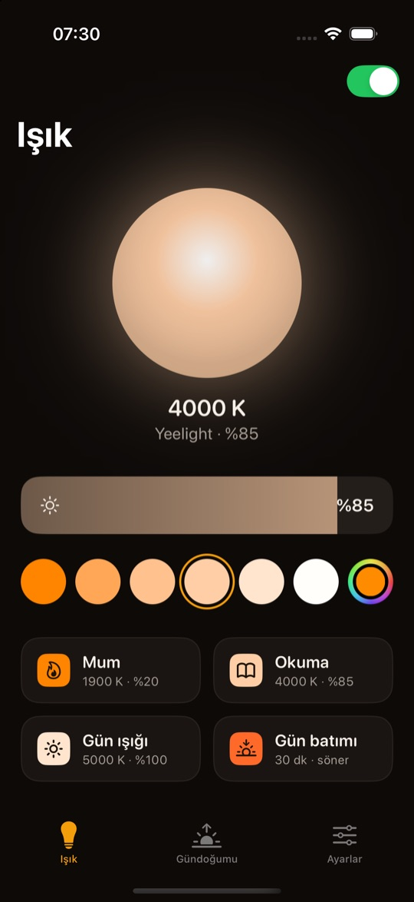
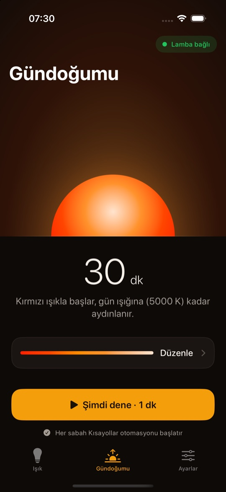
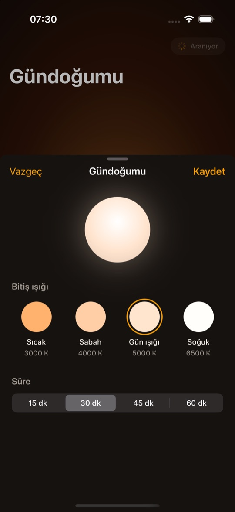
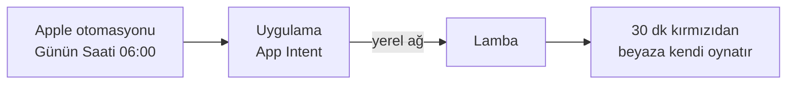

# Sunrise Lamp

Odadaki akıllı ampulü gündoğumu alarmına çeviren bir iPhone uygulaması. Lamba uyanmadan önce kırmızıdan beyaza yavaşça aydınlanır, seni ışık uyandırır.

<table>
  <tr>
    <td align="center" width="33%"><br><b>Işık</b><br>günlük lamba kumandası</td>
    <td align="center" width="33%"><br><b>Gündoğumu</b><br>sabahki ışık</td>
    <td align="center" width="33%"><br><b>Düzenle</b><br>seçtiğin renk lambada önizlenir</td>
  </tr>
</table>

## Nasıl yaptık

1. **Lambayı ağda aradık.** Ev ağındaki cihazları taradık, lamba yoktu. Resetlenmiş, kendi kurulum Wi-Fi'ını açmıştı. Ağ adından modeli öğrendik: Yeelight 1S Color.
2. **Ev ağına aldık, LAN Control'ü açtık.** Wi-Fi bilgisini bir script ile lambaya gönderdik. Yeelight uygulamasından LAN Control'ü açtık; bu ayar kapalıyken lamba yerel ağdan komut kabul etmiyor.
3. **Dokümantasyona baktık.** Yeelight yerel kontrol protokolünü açıkça yayımlıyor, tersine mühendislik gerekmedi. Lamba bir keşif isteğine IP'siyle ve bildiği komutlarla cevap veriyor.
4. **Terminalden ilk komutu attık.** Aynı ağda olduğumuz için lambanın IP'sine TCP ile tek satır JSON gönderdik. Protokolde "color flow" diye bir komut var: renk ve parlaklık adımlarını süreleriyle verirsin, lamba geçişi kendisi yapar.
5. **Lamba kırmızıda takıldı.** Komutta adım sayısını yanlış vermiştik, lamba ilk adımda durdu. Düzeltince kırmızıdan beyaza akış çalıştı.
6. **Zamanlamayı iPhone'a verdik.** İlk sürüm Mac'te zamanlanmış bir görevdi, ama kapak kapanınca Mac uyuyordu. Şimdi iPhone'daki Apple Kısayollar otomasyonu her sabah uygulamanın eylemini çalıştırıyor, uygulama da aynı komutu yolluyor.

## Her sabah ne oluyor

Telefon tek mesaj atar, gerisini lamba yapar.



İnternet yok, hesap yok. Telefon kilitli kalabilir.

> **Tek cümleyle:** Apple Kısayollar otomasyonu sabah uygulamayı çalıştırır, uygulama yerel ağdan lambaya tek bir komut yollar, lamba 30 dakikalık gündoğumunu kendisi oynatır.

## Sabah alarmını kur

1. Uygulamayı lambayla aynı Wi-Fi'da bir kez aç ve Yerel Ağ iznini ver.
2. Gündoğumu süresini (15 ile 60 dk) ve bitiş ışığını seç.
3. Kısayollar'da **Otomasyon › Yeni Otomasyon › Günün Saati**: uyanma saatinden gündoğumu süresi kadar önceyi ve günleri seç, **Hemen Çalıştır**'ı işaretle.
4. **Gün doğumunu başlat** eylemini ekle. İstersen arkasına **Müzik Çal** ekle. Uygulamaya dönüp **Kurdum**'a dokun.

Süreyi sonradan değiştirirsen uygulama, uyanma saatin aynı kalsın diye otomasyonu kaydırmanı hatırlatır.

## Kendin de yapmak ister misin?

Bu repo sadece Yeelight için. Tek şart: lamban dakikalar süren renk geçişini kendisi oynatabilmeli (örneğin Hue köprüsü yapabiliyor), çünkü Kısayollar uygulamaya sadece birkaç saniye verir. Aşağıdaki prompt'u Claude Code veya Cursor gibi bir araca repo ile birlikte ver.

<details>
<summary><b>Prompt'u göster</b></summary>

```text
This repository is an iOS sunrise alarm app for Yeelight bulbs. Read README.md
and the code under Sources/SunriseCore and iOS/SunriseLampPhone first.

I want the same app for my lamp instead: <brand and model>.
It is controlled through: <local API / hub / cloud API, with a link to its docs>.

1. Before changing anything, tell me whether my lamp can play a timed
   transition (colour or colour temperature and brightness over minutes) on its
   own, without the phone sending steps. If it cannot, stop and explain the
   options.
2. Write a new client that conforms to LampClientProtocol in
   Sources/SunriseCore/Lamp. Map each LampCommand case to my lamp's API:
   sunrise and sunset as the lamp's own timed transition, plus temperature,
   colour, power on and power off. Keep the sunrise colours and timings from
   LampCommand.sunriseFlow.
3. Add whatever my lamp needs to connect (hub pairing, an API key, a bridge IP)
   and store it with SettingsStore. Never commit keys.
4. Replace YeelightClient() in SunriseLampPhoneApp.swift and LampIntents.swift
   with the new client, and update the "Yeelight" text in the UI.
5. Add tests for the new command mapping next to the existing ones, and make
   sure swift test passes.
```

</details>

## Gereksinimler

- iOS 17 veya üstü
- Xcode 16 veya üstü (Swift 6)
- Aynı Wi-Fi'da, Yeelight uygulamasında **LAN Control** açık bir Yeelight renkli ampul

## Derleme

1. `iOS/SunriseLampPhone.xcodeproj` dosyasını Xcode'da aç.
2. Signing & Capabilities altında kendi takımını seç (Xcode isterse bundle identifier'ı değiştir).
3. iPhone'unda çalıştır.

Ortak mantık repo kökündeki `SunriseCore` Swift paketinde. Testleri Mac'te çalışır:

```bash
swift test
```

## Lisans

MIT
